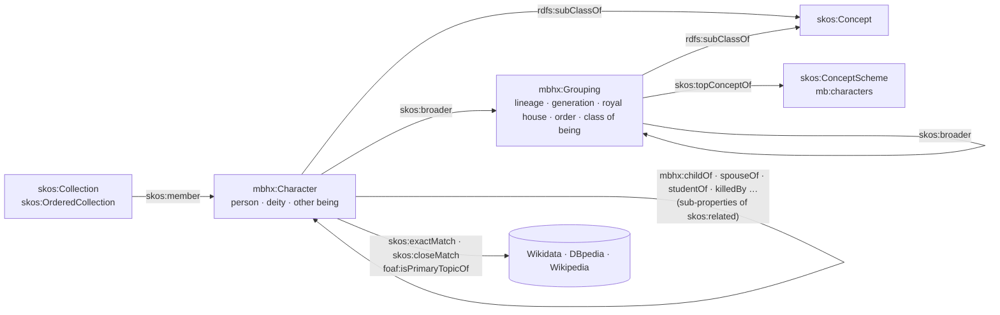
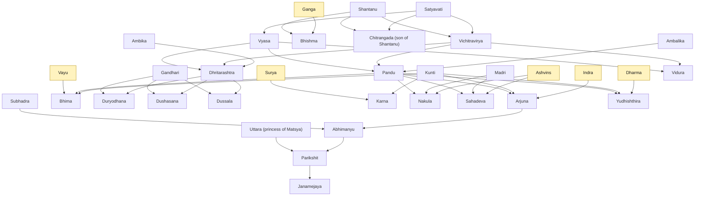

# Characters of the Mahabharata: a SKOS concept scheme

[](https://www.w3.org/TR/skos-reference/)
[](mahabharata_characters.ttl)
[](shapes.ttl)
[](LICENSE)
[](LICENSE-CODE)
[](https://mahabharata.tanay.uk/)

A knowledge organisation system for the people, gods and other beings of the *Mahabharata*, written in [SKOS](https://www.w3.org/TR/skos-reference/) and published as RDF Turtle.

Every character is a `skos:Concept` placed under the lineage, royal house, order or class of being the epic gives it. Kinship and narrative ties between characters (parent, spouse, teacher, killer, charioteer, rebirth, curse) are sub-properties of `skos:related`. Labels are given in English, in Sanskrit in Devanagari and in IAST transliteration, with epithets as alternative labels and common spellings as hidden labels. Every character with an English Wikipedia article is mapped to its Wikidata item and DBpedia resource. A SHACL shapes file checks the SKOS integrity conditions and the conventions of the scheme, and continuous integration runs it on every push.

The content follows the Wikipedia article [Mahabharata](https://en.wikipedia.org/wiki/Mahabharata) and the character articles it links to. The full specification, with an entry for every term, is published at [mahabharata.tanay.uk](https://mahabharata.tanay.uk/); every IRI of the scheme resolves to its entry there.

## Contents

- [At a glance](#at-a-glance)
- [A concept, in Turtle](#a-concept-in-turtle)
- [The model](#the-model)
  - [Hierarchy](#hierarchy)
  - [Labels](#labels)
  - [Relations between characters](#relations-between-characters)
  - [Collections](#collections)
  - [Mappings](#mappings)
- [The Kuru family tree](#the-kuru-family-tree)
- [Using the scheme](#using-the-scheme)
- [Validation](#validation)
- [Repository layout](#repository-layout)
- [Design decisions](#design-decisions)
- [Scope and sources](#scope-and-sources)
- [Website and namespace](#website-and-namespace)
- [Contributing](#contributing)
- [Licence](#licence)
- [Citation](#citation)

## At a glance

<!-- stats:start -->
<!-- Generated by scripts/render_docs.py from mahabharata_characters.ttl. Edit the data, not this text. -->
| Measure | Value |
|---|---|
| Triples | 2,569 |
| Characters (`mbhx:Character`) | 111 |
| Groupings (`mbhx:Grouping`) | 37, of which 8 top concepts |
| Collections | 11, of which 3 ordered |
| Preferred labels | 433 (en 159 · sa-Deva 137 · sa-Latn 137) |
| Alternative labels (epithets, patronymics, names in disguise) | 257 |
| Hidden labels (spelling variants) | 139 |
| Relations between characters | 202 statements over 12 properties |
| Characters with a day of the war on which they fell | 35 |
| Characters under more than one grouping | 15 |
| Characters mapped to Wikidata | 102 of 111 |
| Characters linked to their Wikipedia article | 96 of 111 |

Characters without a Wikidata item of their own, linked to the Wikipedia list article instead: Alambusha, Durmasena, Prativindhya, Radha (foster mother of Karna), Shatanika, Shrutakarma, Shrutasena, Somadatta, Sutasoma.
<!-- stats:end -->

## A concept, in Turtle

Arjuna, trimmed to the essentials (the file also carries eleven more epithets and a `skos:note` on his part in the story):

```turtle
mbh:arjuna a mbhx:Character, skos:Concept ;
    skos:inScheme    mb:characters ;
    skos:broader     mbh:pandavas ;
    skos:prefLabel   "Arjuna"@en, "अर्जुन"@sa-Deva, "Arjuna"@sa-Latn ;
    skos:altLabel    "Partha"@en, "Dhananjaya"@en, "Savyasachi"@en, "Brihannala"@en,
                     "पार्थ"@sa-Deva, "Pārtha"@sa-Latn ;
    skos:hiddenLabel "Arjun"@en, "Arjunan"@en ;
    skos:definition  "Third Pandava, son of Kunti and Indra, the greatest archer of the epic, Krishna's friend and brother-in-law, and the hearer of the Bhagavad Gita."@en ;
    mbhx:childOf     mbh:kunti, mbh:pandu, mbh:indra ;
    mbhx:studentOf   mbh:drona ;
    mbhx:friendOf    mbh:krishna ;
    mbhx:rivalOf     mbh:karna ;
    skos:exactMatch  wd:Q185790, dbr:Arjuna ;
    foaf:isPrimaryTopicOf wp:Arjuna .
```

## The model



The scheme has two kinds of concept. A **`mbhx:Character`** is a person, deity or other being that acts or is named in the epic. A **`mbhx:Grouping`** is a lineage, generation, royal house, order or class of being under which characters are placed. Both are subclasses of `skos:Concept` and they are disjoint.

`skos:broader` runs from a character to its groupings and from a grouping to a wider grouping. A character is never broader than another character: the hierarchy is a classification, not a genealogy. Family ties are expressed as relations instead, so `skos:broader+` always means "belongs to", and `mbhx:childOf+` always means "descends from".

### Hierarchy

<!-- top-concepts:start -->
<!-- Generated by scripts/render_docs.py from mahabharata_characters.ttl. Edit the data, not this text. -->
| Top concept | Sanskrit | Covers | Characters |
|---|---|---|---|
| **House of Kuru** | Kuruvaṁśa | The royal lineage of Hastinapura descended from King Kuru, to which both the Pandavas and the Kauravas belong. | 42 |
| **Yadavas** | Yādava | The clan of Krishna, descended from Yadu, including the Vrishni, Andhaka and Bhoja branches, with their capital at Dwaraka. | 8 |
| **Royal house of Panchala** | Pāñcāla | The royal family of the Panchala kingdom under Drupada, allied by marriage to the Pandavas through Draupadi. | 6 |
| **Other royal houses** |  | Royal families of kingdoms other than Kuru, Yadava and Panchala whose members act in the epic, grouped by kingdom. | 29 |
| **Brahmins and sages** |  | Brahmin characters: the sages who compose, narrate and intervene in the story, and the Brahmin warriors who teach arms to the Kuru princes. | 13 |
| **Sutas** | Sūta | Members of the suta class of charioteers and bards: the epic's reciter Ugrashravas, Dhritarashtra's narrator Sanjaya, and Karna's foster family. | 5 |
| **Deities and celestial beings** | Deva | Gods, goddesses and celestial beings who father, marry, test, arm or curse the human characters. | 13 |
| **Rakshasas, Nagas and Asuras** |  | Non-human peoples of the epic other than the gods: the rakshasas the Pandavas fight and marry, the serpent Nagas, and the asura architect Maya. | 10 |

The character column sums to 126 for 111 characters because 15 placements are second placements of characters that belong to two groupings.
<!-- top-concepts:end -->

The groupings, with the number of characters each one covers:

<!-- groupings:start -->
<!-- Generated by scripts/render_docs.py from mahabharata_characters.ttl. Edit the data, not this text. -->
- House of Kuru · Kuruvaṁśa (42)
  - House of Kuru: generation of Shantanu (8)
  - House of Kuru: generation of Pandu (6)
  - Pandavas · Pāṇḍava (5)
  - Kauravas · Kaurava (5)
  - Consorts of the Pandavas (5)
  - Children of the Pandavas (9)
    - Upapandavas · Upapāṇḍava (5)
  - Children of the Kauravas (2)
  - House of Kuru: kings after the war (2)
- Yadavas · Yādava (8)
- Royal house of Panchala · Pāñcāla (6)
- Other royal houses (29)
  - Royal house of Matsya · Matsya (5)
  - Royal house of Madra · Madra (2)
  - Royal house of Gandhara · Gāndhāra (3)
  - Royal house of Anga · Aṅga (2)
  - Royal house of Kashi · Kāśī (3)
  - Royal house of Sindhu · Sindhu (1)
  - Royal house of Magadha · Magadha (1)
  - Royal house of Chedi · Cedi (2)
  - Royal house of Pragjyotisha · Prāgjyotiṣa (1)
  - Royal house of Trigarta · Trigarta (1)
  - Royal house of Kamboja · Kamboja (1)
  - Royal house of Bahlika · Bāhlīka (3)
  - Royal house of the Nishadas · Niṣāda (1)
  - Royal house of Vidarbha · Vidarbha (1)
  - Royal house of Manipura · Maṇipura (2)
- Brahmins and sages (13)
  - Sages · Ṛṣi (9)
  - Brahmin warriors of the Kuru court (4)
- Sutas · Sūta (5)
- Deities and celestial beings · Deva (13)
- Rakshasas, Nagas and Asuras (10)
  - Rakshasas · Rākṣasa (7)
  - Nagas · Nāga (2)
  - Asuras and Danavas · Asura (1)
<!-- groupings:end -->

The full hierarchy with every character, its Sanskrit labels and its Wikidata item is in [docs/hierarchy.md](docs/hierarchy.md).

### Labels

| Property | Languages | Holds |
|---|---|---|
| `skos:prefLabel` | `en`, `sa-Deva`, `sa-Latn` | One name per language. English labels are unique across the scheme. Sanskrit uses the dictionary stem (*Aśvatthāman*, *Bhūriśravas*); the familiar nominative (*Aśvatthāmā*) is an alternative label. |
| `skos:altLabel` | `en`, `sa-Deva`, `sa-Latn` | Epithets, patronymics and matronymics (*Partha*, *Radheya*, *Saubala*), and the names taken in disguise at Virata's court (*Brihannala*, *Kanka*, *Sairandhri*). |
| `skos:hiddenLabel` | `en` | Common English spellings for search (*Bheem*, *Dhritrashtra*, *Yudhisthir*). Not meant for display. |

Bhishma, for example:

| | |
|---|---|
| Preferred | Bhishma · भीष्म · Bhīṣma |
| Alternative | Devavrata, Gangaputra, Gangeya, Shantanava, Pitamaha · देवव्रत · Devavrata, Gāṅgeya |
| Hidden | Bhishm, Bheeshma |

Characters who share a name are told apart in the label itself: *Chitrangada (son of Shantanu)* and *Chitrangada (princess of Manipura)*; *Uttara (prince of Matsya)* and *Uttara (princess of Matsya)*; *Radha (foster mother of Karna)*. Each carries a `skos:scopeNote` pointing to the other.

### Relations between characters

Relations are sub-properties of `skos:related` declared in the small schema at the top of the Turtle file (namespace `mbhx:`). Specialising SKOS this way is the pattern the [SKOS Primer, section 4.7](https://www.w3.org/TR/skos-primer/#secskosspecialization) describes: every `mbhx:killedBy` statement is also a `skos:related` statement for a tool that knows only SKOS, and a tool that knows the schema gets the finer meaning.

<!-- relations:start -->
<!-- Generated by scripts/render_docs.py from mahabharata_characters.ttl. Edit the data, not this text. -->
| Property | Inverse | Stated | Meaning |
|---|---|---|---|
| `mbhx:childOf` | `mbhx:parentOf` | 82 | The subject is a child of the object, as the epic states parentage. |
| `mbhx:killedBy` | `mbhx:killed` | 45 | The object struck the blow that killed the subject, or in Bhishma's case the blow that brought him down. |
| `mbhx:spouseOf` | symmetric | 21 | The subject and the object are married. |
| `mbhx:studentOf` | `mbhx:teacherOf` | 19 | The object taught the subject, in arms or in learning. |
| `mbhx:siblingOf` | symmetric | 11 | The subject and the object share a parent. |
| `mbhx:charioteerOf` | `mbhx:hasCharioteer` | 5 | The subject drove the object's chariot. |
| `mbhx:rivalOf` | symmetric | 5 | A personal enmity the epic treats as a defining bond. |
| `mbhx:cursed` | `mbhx:cursedBy` | 4 | The subject pronounced a curse on the object that takes effect in the story. |
| `mbhx:avatarOf` | `mbhx:hasAvatar` | 3 | The subject is an incarnation of the deity named by the object. |
| `mbhx:fosterChildOf` | `mbhx:fosterParentOf` | 3 | The subject was raised by the object without being born to them. |
| `mbhx:friendOf` | symmetric | 3 | A friendship the epic treats as a defining bond. |
| `mbhx:rebirthOf` | `mbhx:rebornAs` | 1 | The subject is the object born again in a later life. |
<!-- relations:end -->

Three conventions keep the relations consistent, and the SHACL shapes enforce them:

- **Each relation is stated once, in the direction the property names.** `mbhx:childOf` is written on the child, `mbhx:killedBy` on the one who was killed, `mbhx:studentOf` on the student. The inverse (`parentOf`, `killed`, `teacherOf`) is declared with `owl:inverseOf` and is available through RDFS/OWL inference or an inverse property path (`^mbhx:killedBy`), never written out.
- **Symmetric relations** (`spouseOf`, `siblingOf`, `friendOf`, `rivalOf`) are typed `owl:SymmetricProperty` and stated once per pair. `siblingOf` is only stated where the shared parent is not a concept in the scheme; otherwise it follows from `childOf`.
- **`childOf` covers what the epic counts as parentage:** birth, fathering by a deity through Kunti's boon, and fatherhood by niyoga (Dhritarashtra, Pandu and Vidura as sons of Vichitravirya; the Pandavas as sons of Pandu). The `skos:note` on each character says which applies.

One datatype property, `mbhx:fellOnWarDay` (an integer from 1 to 18), records the day of the Kurukshetra war on which a character was struck down.

### Collections

Collections gather characters across the hierarchy. An ordered collection is used where the order carries meaning; it states both `skos:memberList` and `skos:member`, so that a consumer without SKOS inference still sees the membership.

<!-- collections:start -->
<!-- Generated by scripts/render_docs.py from mahabharata_characters.ttl. Edit the data, not this text. -->
| Collection | Label | Kind | Members |
|---|---|---|---|
| `mbh:coll-pandavas-by-birth` | The five Pandavas in order of birth | ordered | 5 |
| `mbh:coll-upapandavas-by-father` | The sons of Draupadi in the order of their fathers' birth | ordered | 5 |
| `mbh:coll-kaurava-commanders` | Commanders-in-chief of the Kaurava army, in sequence | ordered | 5 |
| `mbh:coll-children-of-kunti` | Children of Kunti |  | 4 |
| `mbh:coll-pandava-side` | Kurukshetra war: the Pandava side |  | 24 |
| `mbh:coll-kaurava-side` | Kurukshetra war: the Kaurava side |  | 23 |
| `mbh:coll-stayed-out` | Warriors who took no part in the war |  | 2 |
| `mbh:coll-survivors` | Survivors of the Kurukshetra war |  | 11 |
| `mbh:coll-narrative-frame` | The narrative frame of the Mahabharata |  | 8 |
| `mbh:coll-chiranjivis` | Immortals (chiranjivis) among the characters |  | 5 |
| `mbh:coll-virata-disguises` | The disguises at Virata's court |  | 6 |
<!-- collections:end -->

### Mappings

| Property | Target | Used when |
|---|---|---|
| `skos:exactMatch` | Wikidata item, DBpedia resource | The external resource is this character. |
| `skos:closeMatch` | Wikidata item, DBpedia resource | The external resource is wider than the concept: a kingdom for a royal house, Yama for the god Dharma. |
| `foaf:isPrimaryTopicOf` | English Wikipedia article | The character has an article of its own. |
| `rdfs:seeAlso` | Wikipedia | A grouping's background article, or the list article for a character without an item of its own. |

Wikidata identifiers were resolved through the Wikipedia API (`prop=pageprops&ppprop=wikibase_item`, following redirects) on 2026-11-08.

## The Kuru family tree

The main line, drawn from the `mbhx:childOf` statements in the data. Arrows run from parent to child; deities are shaded. Vyasa and Vichitravirya both appear as fathers of Dhritarashtra, Pandu and Vidura because the epic records both: Vyasa by birth, Vichitravirya by niyoga.

<!-- family-tree:start -->
<!-- Generated by scripts/render_docs.py from mahabharata_characters.ttl. Edit the data, not this text. -->

<!-- family-tree:end -->

The complete tree, with every parent-child and foster link in the data, is in [docs/family-tree.md](docs/family-tree.md).

## Using the scheme

### Python with rdflib

```python
from rdflib import Graph, Namespace
from rdflib.collection import Collection
from rdflib.namespace import SKOS

g = Graph().parse("mahabharata_characters.ttl")
MBH = Namespace("https://mahabharata.tanay.uk/characters#")
MBHX = Namespace("https://mahabharata.tanay.uk/schema#")

def label(node, lang="en"):
    return next(str(l) for l in g.objects(node, SKOS.prefLabel) if l.language == lang)

# Relations are stated in one direction: killedBy on the one who was killed.
print(sorted(label(c) for c in g.subjects(MBHX.killedBy, MBH.bhima)))

# Walk up the hierarchy.
print([label(b) for b in g.transitive_objects(MBH.draupadi, SKOS.broader) if b != MBH.draupadi])

# Read an ordered collection in order.
head = g.value(MBH["coll-kaurava-commanders"], SKOS.memberList)
print([label(m) for m in Collection(g, head)])
```

### SPARQL

```sparql
PREFIX skos: <http://www.w3.org/2004/02/skos/core#>
PREFIX mbh:  <https://mahabharata.tanay.uk/characters#>
PREFIX mbhx: <https://mahabharata.tanay.uk/schema#>

# Everyone who descends from Shantanu, by stated parentage
SELECT ?name WHERE {
  ?c mbhx:childOf+ mbh:shantanu ;
     skos:prefLabel ?name .
  FILTER(lang(?name) = "en")
} ORDER BY ?name
```

Ten worked queries, each with the result it returns against the current data, are in [docs/queries.md](docs/queries.md).

### Other tools

The file is plain Turtle, so it opens in Protégé, TopBraid Composer, Skosmos (through a SPARQL endpoint such as Fuseki) and any RDF library. With Apache Jena: `riot --validate mahabharata_characters.ttl` checks the syntax and `arq --data=mahabharata_characters.ttl --query=q.rq` runs a query. If a tool wants RDF/XML, JSON-LD or N-Triples instead, `python scripts/export.py` writes all three to `dist/`.

## Validation

```sh
pip install -r requirements.txt
python scripts/validate.py        # or: make validate
```

The validator parses the Turtle, runs the shapes in [shapes.ttl](shapes.ttl) with [pySHACL](https://github.com/RDFLib/pySHACL) under RDFS inference (so that sub-properties and subclasses count), checks that every `mbh:` IRI used in the file is also declared, and prints the counts and sample traversals. It exits non-zero on any violation, and the [GitHub Actions workflow](.github/workflows/validate.yml) runs it, together with a check that the generated documentation and the website still match the data, on every push and pull request.

The shapes have two layers:

| Layer | What is checked |
|---|---|
| SKOS integrity conditions (S9, S13, S14, S19, S27, S36, S37, S46 of the [SKOS Reference](https://www.w3.org/TR/skos-reference/)) | At most one `prefLabel` per language; `prefLabel`, `altLabel` and `hiddenLabel` pairwise disjoint; a concept is neither a scheme nor a collection; `broader` points at concepts; `related` is disjoint with the transitive hierarchy; an ordered collection has exactly one well-formed member list that agrees with `skos:member`; `exactMatch` is disjoint with `broadMatch` and `relatedMatch`. |
| Conventions of this scheme | Every concept has an English preferred label and definition and is in the scheme; it is a top concept or has a broader concept, never both; a character sits under groupings only and is never a top concept; a grouping has narrower concepts and carries no character relations; relations connect characters to characters, in one direction only, symmetric ones once per pair, with no self-relations and no parent-child cycles; mapping IRIs match the Wikidata, DBpedia and Wikipedia patterns; every character has an external anchor; `fellOnWarDay` is an integer from 1 to 18. |

## Repository layout

```
mahabharata/
├── mahabharata_characters.ttl   the concept scheme, the mbhx: schema and the collections (source of truth)
├── shapes.ttl                   SHACL shapes
├── index.html                   the specification website, generated (served at mahabharata.tanay.uk)
├── characters.html              namespace documents for mbh:, mbhx: and mbsh:, generated;
├── schema.html                  each forwards to the matching entry of index.html
├── shapes.html
├── CNAME · .nojekyll            GitHub Pages: the custom domain; serve every file as it is
├── scripts/
│   ├── validate.py              syntax + SHACL + dangling-IRI check, with a summary
│   ├── render_docs.py           regenerates docs/ and the generated blocks of this README from the data
│   ├── render_site.py           regenerates index.html and the namespace documents from the data
│   └── export.py                writes RDF/XML, JSON-LD and N-Triples copies to dist/
├── docs/
│   ├── hierarchy.md             every concept in its place, with labels and Wikidata items
│   ├── family-tree.md           every parent-child link as a Mermaid diagram
│   └── queries.md               SPARQL cookbook with live results
├── .github/workflows/validate.yml
├── Makefile                     validate · docs · site · check · export
├── requirements.txt             rdflib, pyshacl
├── CONTRIBUTING.md              how to add or correct a character
├── CHANGELOG.md
├── CITATION.cff
├── LICENSE                      CC BY-SA 4.0 (data and documentation)
└── LICENSE-CODE                 MIT (scripts)
```

The sections of this README marked `<!-- name:start -->` … `<!-- name:end -->` and everything under `docs/` are generated by `scripts/render_docs.py`; `index.html` and the three namespace documents by `scripts/render_site.py`. Edit the Turtle, run `make docs`, and commit everything that changed.

## Design decisions

- **SKOS with a thin schema, not a full OWL ontology.** The purpose is indexing, navigation and linking. Keeping every character a `skos:Concept` means any SKOS browser can display the scheme, and specialising `skos:related` (SKOS Primer §4.7) adds the kinship vocabulary without leaving SKOS semantics. The schema has two classes, one datatype property and the relation properties, and nothing else.
- **Classification in `broader`, genealogy in relations.** Mixing the two is the common SKOS anti-pattern (a son "narrower than" his father). Separating them keeps `skos:broader+` meaningful for retrieval ("all characters of the House of Kuru") and keeps the family tree queryable on its own.
- **Polyhierarchy where the epic has it.** Draupadi is a Panchala by birth and a consort of the Pandavas by marriage; Krishna is a Yadava and the avatar of Vishnu; Karna is a suta's son and the king of Anga. Each is placed under both.
- **One direction per relation, inverses by inference.** Writing both directions doubles the maintenance and lets the two drift apart. The shapes reject a materialised inverse.
- **Homonyms split, identities merged where the epic merges them.** The two Chitrangadas and the two Uttaras are separate concepts with cross-references. Dharma and Yama are one concept, as the epic treats them, with a `skos:scopeNote` saying why and a `closeMatch` to Yama. The Ashvins are one concept because the epic treats the twins as a pair in their only role here.
- **Every statement checkable.** Every character carries a Wikidata or DBpedia mapping, or a link to the Wikipedia list article where no item exists. The documentation is generated from the data, and CI fails when the two disagree.

## Scope and sources

The scheme covers the characters named in the synopsis of the Wikipedia article and the principal figures of the Kurukshetra war. The epic names many hundreds more (the Kauravas alone are a hundred brothers); the Wikipedia [list of characters](https://en.wikipedia.org/wiki/List_of_characters_in_the_Mahabharata) is the natural source for additions.

Parentage, deaths and the days on which warriors fell follow the Wikipedia articles, which follow the Critical Edition of the Bhandarkar Oriental Research Institute and note the variants. Where recensions differ, the commonly cited reading is used. Devanagari and IAST forms follow standard dictionary practice.

Sources: [Mahabharata](https://en.wikipedia.org/wiki/Mahabharata) and [List of characters in the Mahabharata](https://en.wikipedia.org/wiki/List_of_characters_in_the_Mahabharata) on English Wikipedia, the character articles linked from them, and [Wikidata](https://www.wikidata.org/) for identifiers.

## Website and namespace

The specification of the scheme is published at **[mahabharata.tanay.uk](https://mahabharata.tanay.uk/)**: a single page in the manner of a W3C vocabulary specification such as [PROV-O](https://www.w3.org/TR/prov-o/), with the model at a glance, the full hierarchy, and a cross-reference entry for every class, property, grouping, character, collection and shape. It is `index.html` in this repository, generated from the Turtle by `scripts/render_site.py`, and GitHub Pages serves the repository root.

Every IRI of the scheme resolves to its entry on that page:

| Prefix | Namespace | Resolves to |
|---|---|---|
| `mb:` | `https://mahabharata.tanay.uk/` | the scheme `mb:characters` and the schema `mb:schema` |
| `mbh:` | `https://mahabharata.tanay.uk/characters#` | concepts and collections: `mbh:arjuna`, `mbh:coll-survivors` |
| `mbhx:` | `https://mahabharata.tanay.uk/schema#` | classes and properties: `mbhx:Character`, `mbhx:childOf` |
| `mbsh:` | `https://mahabharata.tanay.uk/shapes#` | the SHACL shapes |

The namespace documents `characters.html`, `schema.html` and `shapes.html` forward to the matching anchor of the specification, so `https://mahabharata.tanay.uk/characters#arjuna` opens the entry for Arjuna. The Turtle itself is served at [mahabharata.tanay.uk/mahabharata_characters.ttl](https://mahabharata.tanay.uk/mahabharata_characters.ttl) and the shapes at [mahabharata.tanay.uk/shapes.ttl](https://mahabharata.tanay.uk/shapes.ttl); the page declares both as `rel="alternate"` links. Local names are stable lower-case ASCII (`mbh:yudhishthira`, `mbh:chitrangada-manipura`, `mbh:coll-survivors`).

To publish under another namespace, change the `mb:`, `mbh:`, `mbhx:` and `mbsh:` prefix declarations in `mahabharata_characters.ttl` and `shapes.ttl`, the namespace constants at the top of the scripts, and `SITE_URL` in `scripts/render_site.py`, then run `make docs`.

### Publishing the site

The source lives at [github.com/ImTanay/mahabharata](https://github.com/ImTanay/mahabharata), and GitHub Pages serves the site from the branch root (Settings → Pages → Source: *Deploy from a branch*, branch `main`, folder `/ (root)`). The file `CNAME` holds the custom domain, `.nojekyll` makes GitHub serve every file as it is, and DNS needs a `CNAME` record from `mahabharata` to `imtanay.github.io`. Any static host works the same way, as long as it serves `schema.html` for the path `/schema` (GitHub Pages, Cloudflare Pages and Netlify all do).

## Contributing

Corrections and additions are welcome. [CONTRIBUTING.md](CONTRIBUTING.md) has the template for a new character, the labelling and relation conventions, and the two commands to run before opening a pull request (`make validate` and `make docs`).

## Licence

- The concept scheme (`mahabharata_characters.ttl`), the shapes and the documentation are released under [Creative Commons Attribution-ShareAlike 4.0 International](LICENSE). The descriptions paraphrase English Wikipedia, whose text is published under CC BY-SA 4.0, so the same licence applies here.
- The scripts under `scripts/` are released under the [MIT License](LICENSE-CODE).

When you reuse the data, credit "Characters of the Mahabharata: a SKOS concept scheme" and Wikipedia, and link to the licence.

## Citation

Author: Tanay Aggarwal

[CITATION.cff](CITATION.cff) carries the same citation in machine-readable form; GitHub uses it for the "Cite this repository" button. Cite the scheme as:

> Aggarwal, Tanay. *Characters of the Mahabharata: a SKOS concept scheme*, version 1.0.0. RDF Turtle dataset, 2026. CC BY-SA 4.0. https://mahabharata.tanay.uk/

```bibtex
@misc{aggarwal2026mahabharata,
  author  = {Aggarwal, Tanay},
  title   = {Characters of the {Mahabharata}: a {SKOS} concept scheme},
  year    = {2026},
  version = {1.0.0},
  url     = {https://mahabharata.tanay.uk/},
  note    = {RDF Turtle dataset, CC BY-SA 4.0}
}
```
