# The family tree

<!-- Generated by scripts/render_docs.py from mahabharata_characters.ttl. Edit the data, not this text. -->

Every `mbhx:childOf` statement in the data (82) drawn as an arrow from parent to child, and every `mbhx:fosterChildOf` (3) as a dashed arrow. Deities are shaded. Two fathers for one child reflect the epic itself: fatherhood by niyoga (Vyasa and Vichitravirya; Pandu and the gods Kunti and Madri invoked) is recorded beside birth. Marriages are not drawn; they are `mbhx:spouseOf` in the data.

```mermaid
flowchart TB
    classDef deity fill:#fff3bf,stroke:#b08900,color:#1a1a1a
    abhimanyu["Abhimanyu"]
    adhiratha["Adhiratha"]
    ambalika["Ambalika"]
    ambika["Ambika"]
    arjuna["Arjuna"]
    ashvins["Ashvins"]:::deity
    ashwatthama["Ashwatthama"]
    babruvahana["Babruvahana"]
    bahlika["Bahlika"]
    balarama["Balarama"]
    bhima["Bhima"]
    bhishma["Bhishma"]
    bhurishravas["Bhurishravas"]
    chitrangada_manipura["Chitrangada (princess of Manipura)"]
    chitrangada_kuru["Chitrangada (son of Shantanu)"]
    dharma["Dharma"]:::deity
    dhrishtadyumna["Dhrishtadyumna"]
    dhrishtaketu["Dhrishtaketu"]
    dhritarashtra["Dhritarashtra"]
    draupadi["Draupadi"]
    drona["Drona"]
    drupada["Drupada"]
    durmasena["Durmasena"]
    duryodhana["Duryodhana"]
    dushasana["Dushasana"]
    dussala["Dussala"]
    gandhari["Gandhari"]
    ganga["Ganga"]:::deity
    ghatotkacha["Ghatotkacha"]
    hanuman["Hanuman"]:::deity
    hidimbi["Hidimbi"]
    indra["Indra"]:::deity
    iravan["Iravan"]
    janamejaya["Janamejaya"]
    karna["Karna"]
    kripi["Kripi"]
    krishna["Krishna"]:::deity
    kunti["Kunti"]
    kuntibhoja["Kuntibhoja"]
    lakshmana_kumara["Lakshmana Kumara"]
    madri["Madri"]
    nakula["Nakula"]
    pandu["Pandu"]
    parikshit["Parikshit"]
    prativindhya["Prativindhya"]
    radha["Radha (foster mother of Karna)"]
    sahadeva["Sahadeva"]
    satyavati["Satyavati"]
    shakuni["Shakuni"]
    shantanu["Shantanu"]
    shatanika["Shatanika"]
    shikhandi["Shikhandi"]
    shishupala["Shishupala"]
    shrutakarma["Shrutakarma"]
    shrutasena["Shrutasena"]
    somadatta["Somadatta"]
    subhadra["Subhadra"]
    sudeshna["Sudeshna"]
    surya["Surya"]:::deity
    sutasoma["Sutasoma"]
    uluka["Uluka"]
    ulupi["Ulupi"]
    uttara["Uttara (prince of Matsya)"]
    uttaraa["Uttara (princess of Matsya)"]
    vasudeva["Vasudeva"]
    vayu["Vayu"]:::deity
    vichitravirya["Vichitravirya"]
    vidura["Vidura"]
    vikarna["Vikarna"]
    virata["Virata"]
    vrishasena["Vrishasena"]
    vyasa["Vyasa"]
    yudhishthira["Yudhishthira"]
    yuyutsu["Yuyutsu"]
    abhimanyu --> parikshit
    adhiratha -. foster .-> karna
    ambalika --> pandu
    ambika --> dhritarashtra
    arjuna --> abhimanyu
    arjuna --> babruvahana
    arjuna --> iravan
    arjuna --> shrutakarma
    ashvins --> nakula
    ashvins --> sahadeva
    bahlika --> somadatta
    bhima --> ghatotkacha
    bhima --> sutasoma
    chitrangada_manipura --> babruvahana
    dharma --> yudhishthira
    dhritarashtra --> duryodhana
    dhritarashtra --> dushasana
    dhritarashtra --> dussala
    dhritarashtra --> vikarna
    dhritarashtra --> yuyutsu
    draupadi --> prativindhya
    draupadi --> shatanika
    draupadi --> shrutakarma
    draupadi --> shrutasena
    draupadi --> sutasoma
    drona --> ashwatthama
    drupada --> dhrishtadyumna
    drupada --> draupadi
    drupada --> shikhandi
    duryodhana --> lakshmana_kumara
    dushasana --> durmasena
    gandhari --> duryodhana
    gandhari --> dushasana
    gandhari --> dussala
    gandhari --> vikarna
    ganga --> bhishma
    hidimbi --> ghatotkacha
    indra --> arjuna
    karna --> vrishasena
    kripi --> ashwatthama
    kunti --> arjuna
    kunti --> bhima
    kunti --> karna
    kunti --> yudhishthira
    kuntibhoja -. foster .-> kunti
    madri --> nakula
    madri --> sahadeva
    nakula --> shatanika
    pandu --> arjuna
    pandu --> bhima
    pandu --> nakula
    pandu --> sahadeva
    pandu --> yudhishthira
    parikshit --> janamejaya
    radha -. foster .-> karna
    sahadeva --> shrutasena
    satyavati --> chitrangada_kuru
    satyavati --> vichitravirya
    satyavati --> vyasa
    shakuni --> uluka
    shantanu --> bhishma
    shantanu --> chitrangada_kuru
    shantanu --> vichitravirya
    shishupala --> dhrishtaketu
    somadatta --> bhurishravas
    subhadra --> abhimanyu
    sudeshna --> uttara
    sudeshna --> uttaraa
    surya --> karna
    ulupi --> iravan
    uttaraa --> parikshit
    vasudeva --> balarama
    vasudeva --> krishna
    vasudeva --> subhadra
    vayu --> bhima
    vayu --> hanuman
    vichitravirya --> dhritarashtra
    vichitravirya --> pandu
    vichitravirya --> vidura
    virata --> uttara
    virata --> uttaraa
    vyasa --> dhritarashtra
    vyasa --> pandu
    vyasa --> vidura
    yudhishthira --> prativindhya
```

